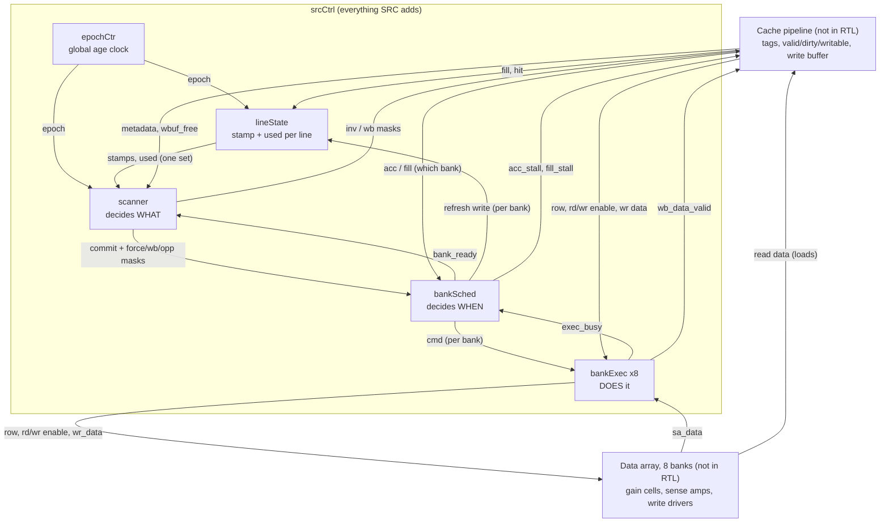

# SRC Refresh Controller — RTL Design Guide

*Selective Retention Cache (SRC), GC-eDRAM L1D. Design as agreed, 4 Oct 2026 (module doc v3.5).*

---

## 1. What this controller is for

### 1.1 The problem

SRC replaces the 32 KiB SRAM L1D with a **48 KiB GC-eDRAM L1D** in the same area. Gain cells are denser and leak less than 6T SRAM, but they **forget**: a cell keeps its charge only for the **data retention time (DRT)**, about **10 µs = 30,030 cycles at 3 GHz**. After that the data is gone.

A conventional ("drop-in") GC-eDRAM cache refreshes **every** line before it dies. SRC is selective:

- **Lines worth keeping** (recently used, or Shared) are **refreshed** before they die.
- **Clean lines nobody uses** are simply **dropped** (invalidated). L2 still has the data.
- **Dirty lines nobody uses** are **written back** to L2, then dropped.

The controller in this document is the hardware that makes those decisions and carries them out.

### 1.2 The one invariant everything protects

> **Every valid line is alive.**
> Each line gets a decision (refresh, drop, or write back + drop) at its **deadline**, before its charge runs out. No line is ever read after it has decayed, and no dirty data is ever lost.

There is no "expiry check" on loads, no inline refresh and no backdoor. Safety comes from the timing bound (§3.4) and is checked in simulation.

### 1.3 Scope: what is in the RTL

`srcCtrl` = **everything SRC adds on top of a plain GC-eDRAM array.** All of it is counted in the synthesized area.

| Inside the RTL (`srcCtrl`) | Outside the RTL |
|---|---|
| Age tracking (`epochCtr`, `lineState`) | Cache pipeline: tags, valid / dirty / coherence bits, LRU, write buffer, MSHRs |
| Decision logic (`scanner`) | Data array: gain cells, row decoder, sense amps, write drivers (area / energy from GEMTOO) |
| Scheduling (`bankSched`) | L2 |
| Refresh datapath: one-line latch + mux per bank (`bankExec`) | |

---

## 2. The big picture

### 2.1 Block diagram



*(If your Markdown viewer does not render Mermaid, the same picture in words: the **scanner** reads one set's ages from **lineState**, decides, and hands a to-do list to **bankSched**; bankSched issues one command at a time to each bank's **bankExec**, which reads the row and writes it back; every refresh restamps the line in lineState.)*

### 2.2 Who decides what

```
scanner     decides WHAT each line needs      (refresh / drop / write back / nothing)
bankSched   decides WHEN each bank does it    (one op per bank at a time, deadline work first)
bankExec    DOES it                           (read row -> latch -> write same row back)
lineState   REMEMBERS when each line was last recharged
epochCtr    is the WALL CLOCK everybody reads
```

### 2.3 The life of one line

1. **Fill.** The line arrives from L2. `lineState`: stamp ← current epoch, used ← 0.
2. **Hits.** Every load / store hit sets used ← 1. The stamp does not change.
3. **Scanner visits** its set about every 64 cycles (at worst 256). It computes the line's age.
4. **Before the deadline** (age 23–28): if kept, it may get an **opportunistic** refresh when its bank is idle.
5. **At the deadline** (age ≥ 29): exactly one of
   - **kept** → forced refresh (stamp ← epoch, used ← 0: a new life begins; it must be used again to survive the next deadline);
   - **clean, not kept** → silently invalidated;
   - **dirty, not kept** → written back to L2, then invalidated (or refreshed if the write buffer is full).

### 2.4 Naming conventions

- Modules: camelCase — `epochCtr`, `lineState`, `scanner`, `bankSched`, `bankExec`, `srcCtrl`.
- Signals: snake_case. `cache_*` / `acc_*` / `fill_*` come from the cache; `bank_*` go to a data-array bank; `cmd_*` are bankSched → bankExec commands; `md_*` is the cache's per-line metadata.
- Reset: asynchronous, active-low (`rst_n`) everywhere.

---

## 3. Global parameters and where the numbers come from

### 3.1 Geometry

| Parameter | Value | Note |
|---|---|---|
| `NUM_SETS` | 64 | 48 KiB / 64 B lines / 12 ways (VIPT-consistent) |
| `NUM_WAYS` | 12 | |
| `NUM_BANKS` | 8 | Power of two. **bank = set[2:0]**, **set_hi = set[5:3]** |
| `LINE_BYTES` | 64 | One line = one physical row of 512 bits |
| Rows per bank | 96 | 8 sets × 12 ways |

All 12 ways of a set live in the **same bank**. Consecutive sets live in **different** banks, so the scanner walking 0, 1, 2, … touches bank 0, 1, 2, …

### 3.2 Timing (from gem5, configuration C1)

| Quantity | Value | Meaning |
|---|---|---|
| Clock | 3 GHz (333 ps) | |
| DRT | 10 µs = **30,030 cycles** | Retention time of the cell |
| SCAN | 1 cycle | Scanner spends 1 cycle per set when the bank is ready |
| LINE | 2 cycles | One bank operation: 1 read + 1 write (refresh), or 1 read + 1 hold (writeback read) |
| **T_SWEEP** | ceil(64/8) × (8×1 + 12×2) = **256 cycles** | Worst-case time between two visits to the same set (all banks working in parallel) |
| Measured sweep | 64 cycles (mean) | 1 set per cycle when idle |

### 3.3 Age: epochs and stamps

Ages are counted in **epochs** of P = 1,024 cycles, not in cycles.

| Parameter | Value | Why |
|---|---|---|
| `EPOCH_LOG2` | 10 | P = 2^10 = 1,024 cycles. A power of two makes the epoch counter the top bits of a free-running counter |
| `STAMP_BITS` | 5 | Ages 0–31 epochs, enough with one epoch of slack (§3.5) |

- Each line stores a **stamp** = the epoch number when it was last fully written (fill or refresh).
- **age = epoch − stamp (mod 32)**. A 5-bit subtraction wraps correctly, like a 12-hour clock.
- A stamp only records *which* epoch, not where inside it, so every threshold rounds **the safe way** (act early, never late).

### 3.4 Thresholds

| Parameter | Value | Formula / meaning |
|---|---|---|
| `DEADLINE_AGE` (F) | **29** | F = floor((DRT − T_GUARD) / P) with T_GUARD = 258 (one sweep + one line). Acts at a true age of 95.5–98.9 % of DRT |
| `OPP_AGE` | **23** | ≈ 0.8 × DRT: opportunistic refresh allowed from here |
| `WBUF_SIZE` | 8 (placeholder) | gem5 `write_buffers` default. Intel publishes no L1D write-buffer size (Skylake has 10 fill buffers, Ice Lake 12) |
| `TOP_MRU` | 0 | Optional "MRU line is also kept" (off) |

**Why F = 29 is safe.** If a visit sees age ≤ 28, the true age is < 29 × 1,024 = 29,696 cycles. The next visit comes within 256 cycles, and the operation finishes within 24 more (12 ops × 2 cycles in the bank): 29,696 + 256 + 24 = 29,976 < 30,030. ✓
(Alternative: T_GUARD = 514 gives F = 28, acting at 92–95.5 %. Flooring already adds up to one epoch of slack, so the spare sweep is not needed.)

### 3.5 Why the 5-bit stamp never wraps on a live line

A valid line is decided at age 29 at the latest (refreshed → age 0, or dropped). The scanner sees every set within one epoch (256 < 1,024 cycles), so the largest age ever read for a valid line is about 30 < 32. Invalid lines' stamps are ignored and overwritten on the next fill.

---

## 4. The policy (CLOCK keep rule)

### 4.1 Per-line inputs

| Input | Source | Meaning |
|---|---|---|
| `valid` | cache | The way holds a line |
| `dirty` | cache | Differs from L2 |
| `writable` | cache (coherence state) | E or M = writable; S or O = not writable |
| `used` | lineState | Hit since its last fill or refresh |
| `age` | epoch − stamp | In epochs |

### 4.2 Two keep rules

```
keep_opp  = used                    // (| mru when TOP_MRU)  -> may be refreshed early
keep_dead = keep_opp | ~writable    // used ONLY at the deadline
```

A **Shared / Owned** line may have a pending upgrade (a store waiting for write permission; the response carries no data and expects the line to still be there). So at the deadline it is never dropped — it is refreshed. It is **not** refreshed opportunistically unless it was also used. This matches gem5 exactly.

### 4.3 Decision table (per way, at one scanner visit)

| Condition | Outcome | Bank time | Write-buffer slot |
|---|---|---|---|
| age < 23 | nothing | – | – |
| 23 ≤ age < 29, `keep_opp` | **opp** (refresh if the bank is idle) | LINE | – |
| 23 ≤ age < 29, not `keep_opp` | nothing | – | – |
| age ≥ 29, `keep_dead` | **force** (refresh now) | LINE | – |
| age ≥ 29, not kept, clean | **inv** (silent drop) | none | none |
| age ≥ 29, not kept, dirty, slot free | **wb + inv** (write back, then drop) | LINE (read) | 1, reserved now |
| age ≥ 29, not kept, dirty, buffer full | **force** (fallback refresh, decided again one DRT later) | LINE | – |

Write-buffer slots are handed out **in way order**: the first `wbuf_free` dirty drops of the set get a slot.

### 4.4 Rules about timing

- **Atomic step.** The scanner reads a set, decides and applies in **one cycle**. Same-cycle hits to a line it invalidates are replayed by the cache as misses.
- **Deadline work beats demand.** Forced refreshes and writeback reads take the bank even if a load wants it; the load stalls.
- **Opportunistic work never stalls demand.** It only starts in a cycle with no demand to that bank.
- **Silent clean drops.** A clean line is dropped without telling L2 (no CleanEvict, no write-buffer slot). Protocol assumption: the level below tolerates stale "L1 holds it" state; L1 answers such snoops with a miss.

---

## 5. Hardware basics used in this design

| Concept | Meaning here |
|---|---|
| **FF (`always_ff`)** | Registers: anything that must be **remembered** across cycles. Uses `<=`. Has the clock and reset |
| **Comb (`always_comb` / `assign`)** | Logic computed fresh every cycle from current inputs and registers. Uses `=`. No clock |
| Path rule | Every path starts at a flop and ends at a flop within one cycle — not necessarily in the same module. The scanner's masks are combinational; they are captured by bankSched's registers and the cache's valid bits |
| `assign` vs `always_comb` | `assign` for one-liners; `always_comb` for loops, `if`s and temporaries. Default every output first (no latches) |
| `for` inside `always_comb` | Unrolled into N parallel copies. Only a variable carried across iterations (like `wb_cnt`) makes a chain |
| `for (genvar …)` outside blocks | Copies whole hardware N times (one per bank). `b` is a constant inside each copy |
| `function` | Reusable piece of combinational logic, copied at every call. No clock, no memory |
| Packed vs unpacked | `logic [4:0] x` is one 5-bit number (packed). `logic x [4:0]` is five 1-bit signals (unpacked). Ports and arithmetic want packed |
| Width trap | `12-bit & 1-bit` zero-extends the 1-bit side → only bit 0 survives. Replicate: `{12{bit}}` or use `bit ? x : '0` |
| Checks | `always @(posedge clk) if (bad) $error("...")` — simulation only, ignored by synthesis |

### 5.1 FF vs comb, per module

| Module | Registers (FF) | Combinational |
|---|---|---|
| `epochCtr` | cycle counter, epoch | – |
| `lineState` | 768 stamps, 768 used bits | read muxes |
| `scanner` | `set_ptr` only | all decisions, `commit`, masks |
| `bankSched` | per bank: `force_pend`, `wb_pend`, `opp_pend`, `set_hi` | pick, commands, `bank_ready`, stalls |
| `bankExec` | `state`, saved row, 512-bit latch | who drives the bank, `exec_busy`, writeback outputs |

---

## 6. Module 1 — `epochCtr`

### Why it is needed

It is the **wall clock**. Instead of 768 per-line counters (768 incrementers, all toggling), there is **one** counter, and each line only remembers what this clock showed when it was recharged.

### Parameters

| Parameter | Value | Meaning |
|---|---|---|
| `EPOCH_LOG2` | 10 | Epoch = 2^10 = 1,024 cycles |
| `STAMP_BITS` | 5 | Epoch width (wraps 31 → 0, which is harmless: ages are mod 32) |

### Ports

| Signal | Dir | Width | From / to | Description |
|---|---|---|---|---|
| `clk`, `rst_n` | in | 1 | | Clock, async active-low reset |
| `epoch` | out | 5 | `lineState`, `scanner` | Current epoch number. +1 every 1,024 cycles |

### Logic

- FF: a 10-bit cycle counter and the 5-bit epoch. When the cycle counter is all ones (last cycle of the epoch), the epoch increments.
- It outputs the epoch **number** (data), never a divided clock. Everything runs on the main `clk`.

### Code

```systemverilog
// Global age clock. One epoch = 2^EPOCH_LOG2 cycles.
// Lines store the epoch at their last recharge; age = epoch - stamp (mod 2^STAMP_BITS).

module epochCtr #(
    parameter int EPOCH_LOG2 = 10,   // log2 of epoch length in cycles
    parameter int STAMP_BITS = 5     // epoch / stamp width
) (
    input  logic                  clk,
    input  logic                  rst_n,
    output logic [STAMP_BITS-1:0] epoch
);

    logic [EPOCH_LOG2-1:0] cycle_cnt;

    always_ff @(posedge clk, negedge rst_n) begin
        if (!rst_n) begin
            cycle_cnt <= '0;
            epoch     <= '0;
        end
        else begin
            cycle_cnt <= cycle_cnt + 1'b1;   // wraps 1023 -> 0 by itself
            if (cycle_cnt == '1)             // last cycle of this epoch
                epoch <= epoch + 1'b1;       // wraps 31 -> 0 by itself
        end
    end

endmodule
```

---

## 7. Module 2 — `lineState`

### Why it is needed

It is the per-line memory of the controller: **when** each line was last recharged (stamp) and **whether** it was used since (used bit). Pure storage — it computes nothing.

### Parameters

| Parameter | Value |
|---|---|
| `NUM_SETS`, `NUM_WAYS`, `NUM_BANKS`, `STAMP_BITS` | 64, 12, 8, 5 |
| `SET_BITS`, `WAY_BITS`, `BANK_BITS`, `SET_HI_BITS` (local) | 6, 4, 3, 3 |

Size: 64 × 12 × (5 + 1) = **4,608 flops**, plus one 64:1 read mux of 72 bits. Likely the largest block of the controller.

### Ports

| Signal | Dir | Width | From / to | Description |
|---|---|---|---|---|
| `clk`, `rst_n` | in | 1 | | |
| `epoch` | in | 5 | `epochCtr` | Value written as the new stamp |
| `wr_fill_en`, `wr_fill_set`, `wr_fill_way` | in | 1, 6, 4 | cache | A line was filled: stamp ← epoch, used ← 0 |
| `wr_refresh_en` | in | 8 | `bankSched.ref_wr_en` | Per bank: a refresh was issued |
| `wr_refresh_set_hi` | in | 8 × 3 | `bankSched.cmd_set_hi` | Per bank: which of its 8 sets |
| `wr_refresh_way` | in | 8 × 4 | `bankSched.cmd_way` | Per bank: which way. stamp ← epoch, used ← 0 |
| `hit_en`, `hit_set`, `hit_way` | in | 1, 6, 4 | cache | A load/store hit: used ← 1 (stamp unchanged) |
| `clr_used_en`, `clr_used_mask` | in | 1, 12 | `scanner` | Clear used bits of `rd_scan_set` (later iteration, tied to 0 now) |
| `rd_scan_set` | in | 6 | `scanner.scan_set` | Set to read |
| `stamps_scan` | out | 12 × 5 | `scanner` | The 12 stamps of that set |
| `used_scan` | out | 12 | `scanner` | The 12 used bits of that set |

### Logic

- **FF:** two packed arrays, `stamps` and `used`. Reset to 0.
- **Write order inside the `always_ff`** (widest first, hit last, because the later assignment wins):
  1. scanner row clear: `used[set] <= used[set] & ~mask` (a *mask of bits to clear*, not a new row value — so a same-cycle hit to another way is not lost);
  2. fill;
  3. refreshes, one port per bank (banks own disjoint sets, so the 8 writes never collide);
  4. hit (newest information wins).
- **Comb:** two read muxes, `stamps[rd_scan_set]` and `used[rd_scan_set]`. One read port only (the scanner).
- A refresh's full set index is `{set_hi, bank}`.

### Code

```systemverilog
module lineState #(
    parameter  int NUM_SETS    = 64,
    parameter  int NUM_WAYS    = 12,
    parameter  int NUM_BANKS   = 8,
    parameter  int STAMP_BITS  = 5,
    localparam int SET_BITS    = $clog2(NUM_SETS),       // 6
    localparam int WAY_BITS    = $clog2(NUM_WAYS),       // 4
    localparam int BANK_BITS   = $clog2(NUM_BANKS),      // 3
    localparam int SET_HI_BITS = SET_BITS - BANK_BITS    // 3
) (
    input  logic                                   clk,
    input  logic                                   rst_n,
    input  logic [STAMP_BITS-1:0]                  epoch,

    // Fill from L2: stamp <= epoch, used <= 0
    input  logic                                   wr_fill_en,
    input  logic [SET_BITS-1:0]                    wr_fill_set,
    input  logic [WAY_BITS-1:0]                    wr_fill_way,

    // Refresh issued, one port per bank: stamp <= epoch, used <= 0
    input  logic [NUM_BANKS-1:0]                   wr_refresh_en,
    input  logic [NUM_BANKS-1:0][SET_HI_BITS-1:0]  wr_refresh_set_hi,
    input  logic [NUM_BANKS-1:0][WAY_BITS-1:0]     wr_refresh_way,

    // Hit: stamp unchanged, used <= 1
    input  logic                                   hit_en,
    input  logic [SET_BITS-1:0]                    hit_set,
    input  logic [WAY_BITS-1:0]                    hit_way,

    // Scanner clears used bits of rd_scan_set (later iteration)
    input  logic                                   clr_used_en,
    input  logic [NUM_WAYS-1:0]                    clr_used_mask,

    // Read port for the scanner
    input  logic [SET_BITS-1:0]                    rd_scan_set,
    output logic [NUM_WAYS-1:0][STAMP_BITS-1:0]    stamps_scan,
    output logic [NUM_WAYS-1:0]                    used_scan
);

    logic [NUM_SETS-1:0][NUM_WAYS-1:0][STAMP_BITS-1:0] stamps;
    logic [NUM_SETS-1:0][NUM_WAYS-1:0]                 used;

    always_ff @(posedge clk, negedge rst_n) begin
        if (!rst_n) begin
            stamps <= '0;
            used   <= '0;
        end
        else begin
            // 1. Scanner clears used bits (whole row, goes first)
            if (clr_used_en)
                used[rd_scan_set] <= used[rd_scan_set] & ~clr_used_mask;

            // 2. Fill from L2
            if (wr_fill_en) begin
                stamps[wr_fill_set][wr_fill_way] <= epoch;
                used  [wr_fill_set][wr_fill_way] <= 1'b0;
            end

            // 3. Refreshes, one per bank (disjoint sets, never collide)
            for (int b = 0; b < NUM_BANKS; b++) begin
                if (wr_refresh_en[b]) begin
                    stamps[{wr_refresh_set_hi[b], BANK_BITS'(b)}][wr_refresh_way[b]] <= epoch;
                    used  [{wr_refresh_set_hi[b], BANK_BITS'(b)}][wr_refresh_way[b]] <= 1'b0;
                end
            end

            // 4. Hit (last: newest information wins)
            if (hit_en)
                used[hit_set][hit_way] <= 1'b1;
        end
    end

    assign stamps_scan = stamps[rd_scan_set];
    assign used_scan   = used[rd_scan_set];

    // ---------------- Checks (simulation only, not hardware) ----------------
    always @(posedge clk) begin
        if (rst_n) begin
            if (wr_fill_en && wr_fill_way >= NUM_WAYS)
                $error("lineState: fill to way %0d out of range", wr_fill_way);
            if (hit_en && hit_way >= NUM_WAYS)
                $error("lineState: hit to way %0d out of range", hit_way);
            if (hit_en && wr_fill_en && hit_set == wr_fill_set && hit_way == wr_fill_way)
                $error("lineState: hit and fill on the same line in one cycle");
        end
    end

endmodule
```

*If an older Icarus rejects `BANK_BITS'(b)`, compute the full set outside the block: `wr_refresh_set[b] = (wr_refresh_set_hi[b] << BANK_BITS) | b;` — the same wires.*

---

## 8. Module 3 — `scanner`

### Why it is needed

It is the **decision maker**. It walks the sets round-robin, and for each set decides the fate of all 12 ways in one cycle, following the policy in §4.

### Parameters

| Parameter | Value |
|---|---|
| `NUM_SETS`, `NUM_WAYS`, `NUM_BANKS`, `STAMP_BITS` | 64, 12, 8, 5 |
| `DEADLINE_AGE`, `OPP_AGE` | 29, 23 (epochs) |
| `WBUF_SIZE` | 8 (placeholder) |
| `SET_BITS`, `BANK_BITS`, `WBUF_BITS` (local) | 6, 3, $clog2(WBUF_SIZE+1) = 4 |

### Ports

| Signal | Dir | Width | From / to | Description |
|---|---|---|---|---|
| `clk`, `rst_n` | in | 1 | | |
| `epoch` | in | 5 | `epochCtr` | Current epoch |
| `stamps_set` | in | 12 × 5 | `lineState.stamps_scan` | Stamps of `scan_set` |
| `used_set` | in | 12 | `lineState.used_scan` | Used bits of `scan_set` |
| `md_valid`, `md_dirty`, `md_writable` | in | 12 each | cache | Metadata of `scan_set` |
| `wbuf_free` | in | 4 | cache | Free write-buffer entries (must already reflect last cycle's reservations) |
| `bank_ready` | in | 8 | `bankSched` | Bank can take a new list |
| `scan_set` | out | 6 | `lineState`, `bankSched`, cache | Set being scanned (= `set_ptr`) |
| `commit` | out | 1 | `bankSched`, cache | 1: decisions applied this cycle, pointer advances. 0: hold this set |
| `force_mask` | out | 12 | `bankSched` | Refresh now (deadline) |
| `opp_mask` | out | 12 | `bankSched` | Refresh if the bank is idle |
| `wb_mask` | out | 12 | `bankSched`, cache | Write back (cache reserves an entry now) |
| `inv_cache_mask` | out | 12 | cache | Invalidate these ways now (clean drops + written-back lines) |
| `clr_used_en`, `clr_used_mask` | out | 1, 12 | `lineState` | Later iteration, tied to 0 |

All masks are zero unless `commit`.

### Logic

- **FF:** only `set_ptr` (6 bits). Reset to 0; +1 when `commit`; wraps 63 → 0.
- **Comb:**
  - `commit = bank_ready[set_ptr[2:0]]` — the set's bank can accept its list.
  - One `always_comb` loop over the 12 ways (unrolled, parallel). Only `wb_cnt` chains across ways (first N dirty drops get a slot).
  - Outputs gated: `mask = commit ? mask_d : '0`.
- **Why the masks are not registered:** the decision must be applied in the same cycle the set was read (atomicity). Registering them would apply a one-cycle-old decision to a set that may have changed. The receivers' registers (bankSched lists, cache valid bits) capture them at the edge.

### Code

```systemverilog
// scanner: walks the sets and decides each line's fate (CLOCK keep rule).
// The step is atomic: read, decide and apply in one cycle, so it is combinational
// except for the set pointer.

module scanner #(
    parameter  int NUM_SETS     = 64,
    parameter  int NUM_WAYS     = 12,
    parameter  int NUM_BANKS    = 8,     // power of two: bank = set[BANK_BITS-1:0]
    parameter  int STAMP_BITS   = 5,
    parameter  int DEADLINE_AGE = 29,    // epochs: act at age >= this
    parameter  int OPP_AGE      = 23,    // epochs: opportunistic refresh from this age
    parameter  int WBUF_SIZE    = 8,     // placeholder (gem5 write_buffers default)
    localparam int SET_BITS     = $clog2(NUM_SETS),        // 6
    localparam int BANK_BITS    = $clog2(NUM_BANKS),       // 3
    localparam int WBUF_BITS    = $clog2(WBUF_SIZE + 1)    // 4
) (
    input  logic                                 clk,
    input  logic                                 rst_n,
    input  logic [STAMP_BITS-1:0]                epoch,

    // From lineState, for scan_set
    input  logic [NUM_WAYS-1:0][STAMP_BITS-1:0]  stamps_set,
    input  logic [NUM_WAYS-1:0]                  used_set,

    // Metadata from the cache, for scan_set
    input  logic [NUM_WAYS-1:0]                  md_valid,
    input  logic [NUM_WAYS-1:0]                  md_dirty,
    input  logic [NUM_WAYS-1:0]                  md_writable,
    input  logic [WBUF_BITS-1:0]                 wbuf_free,

    // From bankSched
    input  logic [NUM_BANKS-1:0]                 bank_ready,

    output logic [SET_BITS-1:0]                  scan_set,
    output logic                                 commit,

    output logic [NUM_WAYS-1:0]                  force_mask,
    output logic [NUM_WAYS-1:0]                  opp_mask,
    output logic [NUM_WAYS-1:0]                  wb_mask,
    output logic [NUM_WAYS-1:0]                  inv_cache_mask,

    output logic                                 clr_used_en,
    output logic [NUM_WAYS-1:0]                  clr_used_mask
);

    logic [SET_BITS-1:0] set_ptr;

    // Internal (ungated) decisions
    logic [NUM_WAYS-1:0] force_d, opp_d, wb_d, inv_d;

    // ---------------- Per-way decision ----------------
    always_comb begin
        logic [STAMP_BITS-1:0] age;
        logic                  deadline, keep_opp, keep_dead, cand_wb, wb;
        logic [WBUF_BITS-1:0]  wb_cnt;                 // write-buffer slots granted so far

        force_d = '0;
        opp_d   = '0;
        wb_d    = '0;
        inv_d   = '0;
        wb_cnt  = '0;

        for (int way = 0; way < NUM_WAYS; way++) begin
            age       = epoch - stamps_set[way];                 // mod 2^STAMP_BITS
            deadline  = md_valid[way] & (age >= DEADLINE_AGE);

            keep_opp  = used_set[way];                           // | mru when TOP_MRU
            keep_dead = keep_opp | ~md_writable[way];            // Shared/Owned kept at deadline

            cand_wb   = deadline & ~keep_dead & md_dirty[way];   // dirty drop wants a slot
            wb        = cand_wb & (wb_cnt < wbuf_free);          // first free slots, way order
            wb_cnt    = wb_cnt + wb;

            force_d[way] = deadline & (keep_dead | (cand_wb & ~wb));      // kept, or no slot
            wb_d[way]    = wb;
            inv_d[way]   = deadline & ~keep_dead & (~md_dirty[way] | wb); // clean drop, or written back
            opp_d[way]   = md_valid[way] & ~deadline & keep_opp & (age >= OPP_AGE);
        end
    end

    // ---------------- Outputs act only on a commit cycle ----------------
    assign force_mask     = commit ? force_d : '0;
    assign opp_mask       = commit ? opp_d   : '0;
    assign wb_mask        = commit ? wb_d    : '0;
    assign inv_cache_mask = commit ? inv_d   : '0;

    assign clr_used_en    = 1'b0;   // later iteration
    assign clr_used_mask  = '0;

    // Banks are interleaved, so the bank is the low bits of the set.
    assign commit   = bank_ready[set_ptr[BANK_BITS-1:0]];
    assign scan_set = set_ptr;

    // ---------------- The only register ----------------
    always_ff @(posedge clk, negedge rst_n) begin
        if (!rst_n)
            set_ptr <= '0;
        else if (commit)
            set_ptr <= set_ptr + 1'b1;   // wraps 63 -> 0
    end

endmodule
```

Notes:
- Temporaries (`age`, `wb_cnt`, …) are declared **inside** the `always_comb` without initializers. A declaration with an initializer inside a procedural block is static and evaluated once — a classic trap.
- `ages >= X` on a packed array would compare one 60-bit number. Compare per way inside the loop.

---

## 9. Module 4 — `bankSched`

### Why it is needed

The scanner spends one cycle per set, but a set can need up to 12 operations of 2 cycles each, all in one bank. Someone has to **remember** each set's to-do list after the scanner moves on and **schedule** the operations bank by bank. That is `bankSched`: the brain that owns the banks.

The 8 banks work **independently and in parallel** (up to one new operation per bank per cycle). That is what the 256-cycle sweep bound assumes.

### Parameters

| Parameter | Value |
|---|---|
| `NUM_SETS`, `NUM_WAYS`, `NUM_BANKS` | 64, 12, 8 |
| `SET_BITS`, `WAY_BITS`, `BANK_BITS`, `SET_HI_BITS` (local) | 6, 4, 3, 3 |

### Ports

| Signal | Dir | Width | From / to | Description |
|---|---|---|---|---|
| `clk`, `rst_n` | in | 1 | | |
| `commit`, `scan_set` | in | 1, 6 | `scanner` | A list is handed over, for this set (bank = `[2:0]`, set_hi = `[5:3]`) |
| `force_mask`, `wb_mask`, `opp_mask` | in | 12 each | `scanner` | The list |
| `acc_valid`, `acc_set` | in | 1, 6 | cache | A load / store / snoop wants bank `acc_set[2:0]` this cycle |
| `fill_valid`, `fill_set` | in | 1, 6 | cache | A fill wants bank `fill_set[2:0]` this cycle |
| `exec_busy` | in | 8 | `bankExec[b]` | Bank b is in the middle of an operation |
| `bank_ready` | out | 8 | `scanner` | Bank b has no forced / writeback work left → can take a new list |
| `cmd_valid` | out | 8 | `bankExec[b]` | Start an operation on bank b now (one-cycle pulse) |
| `cmd_is_wb` | out | 8 | `bankExec[b]` | 1 = writeback read, 0 = refresh |
| `cmd_set_hi` | out | 8 × 3 | `bankExec[b]`, `lineState` | Which of bank b's 8 sets |
| `cmd_way` | out | 8 × 4 | `bankExec[b]`, `lineState` | Which way |
| `ref_wr_en` | out | 8 | `lineState` | A refresh was issued on bank b: restamp it |
| `acc_stall` | out | 1 | cache | The load/store's bank is taken this cycle |
| `fill_stall` | out | 1 | cache | The fill's bank is taken this cycle |

*(Optional rename for consistency: `acc_*` → `cache_acc_*`, `fill_*` → `cache_fill_*`.)*

### Logic

**FF, per bank:** `force_pend[12]`, `wb_pend[12]`, `opp_pend[12]`, `set_hi[3]` — the to-do list. These must outlive the cycle the scanner handed them over (the scanner has already moved on). ~39 flops per bank, ~312 in total.

**Comb, every cycle, per bank b:**
1. `demand = (acc_valid & acc_set[2:0] == b) | (fill_valid & fill_set[2:0] == b)`
2. `free = ~exec_busy[b]`
3. Pick, only if free, first match wins:
   1. lowest way in `force_pend` → refresh
   2. else lowest way in `wb_pend` → writeback read
   3. else lowest way in `opp_pend`, **only if `~demand`** → refresh
4. Outputs: `cmd_valid`, `cmd_is_wb`, `cmd_set_hi = set_hi`, `cmd_way`, `ref_wr_en = cmd_valid & ~cmd_is_wb`
5. `bank_ready[b] = ~|force_pend & ~|wb_pend` — from registers only (otherwise a combinational loop with the scanner's `commit`)

**FF update at the edge, per bank, in order:**
1. If a command was issued: clear the picked bit.
2. If `commit` and the scanned set is in this bank: load the three masks and `set_hi` (after the clear, so the load wins; opportunistic leftovers are replaced).

**Comb, shared:** `taken[b] = cmd_valid[b] | exec_busy[b]`; `acc_stall = acc_valid & taken[acc bank]`; `fill_stall = fill_valid & taken[fill bank]`.

### Example: bank 1 gets `force` on ways 2 and 7

| Cycle | `exec_busy[1]` | Command | Demand to bank 1 |
|---|---|---|---|
| t | – | – (scanner commits, list loads at the edge) | free |
| t+1 | 0 | refresh way 2 | stalls |
| t+2 | 1 | – | stalls |
| t+3 | 0 | refresh way 7 | stalls |
| t+4 | 1 | – (`bank_ready[1]` = 1) | stalls |
| t+5 | 0 | – | free |

### Code

```systemverilog
// bankSched: decides WHEN each bank does its refresh / writeback work.
// The scanner hands over one set's to-do list per commit; each bank keeps its
// list in registers and issues one command at a time to its bankExec.
// Priority per bank: forced refresh > writeback read > opportunistic refresh
// (opportunistic only when no demand wants the bank this cycle).

module bankSched #(
    parameter  int NUM_SETS    = 64,
    parameter  int NUM_WAYS    = 12,
    parameter  int NUM_BANKS   = 8,                      // power of two
    localparam int SET_BITS    = $clog2(NUM_SETS),       // 6
    localparam int WAY_BITS    = $clog2(NUM_WAYS),       // 4
    localparam int BANK_BITS   = $clog2(NUM_BANKS),      // 3
    localparam int SET_HI_BITS = SET_BITS - BANK_BITS    // 3
) (
    input  logic                                   clk,
    input  logic                                   rst_n,

    // From scanner: one set's to-do list
    input  logic                                   commit,
    input  logic [SET_BITS-1:0]                    scan_set,
    input  logic [NUM_WAYS-1:0]                    force_mask,
    input  logic [NUM_WAYS-1:0]                    wb_mask,
    input  logic [NUM_WAYS-1:0]                    opp_mask,

    // From cache: demand traffic this cycle
    input  logic                                   acc_valid,
    input  logic [SET_BITS-1:0]                    acc_set,
    input  logic                                   fill_valid,
    input  logic [SET_BITS-1:0]                    fill_set,

    // From bankExec: bank is in the middle of an operation
    input  logic [NUM_BANKS-1:0]                   exec_busy,

    // To scanner: bank can take a new list
    output logic [NUM_BANKS-1:0]                   bank_ready,

    // To bankExec (and lineState for refreshes): one command per bank
    output logic [NUM_BANKS-1:0]                   cmd_valid,
    output logic [NUM_BANKS-1:0]                   cmd_is_wb,     // 1 = wb, 0 = refresh
    output logic [NUM_BANKS-1:0][SET_HI_BITS-1:0]  cmd_set_hi,    // set MSBs; LSBs = bank id
    output logic [NUM_BANKS-1:0][WAY_BITS-1:0]     cmd_way,
    output logic [NUM_BANKS-1:0]                   ref_wr_en,     // restamp in lineState

    // To cache
    output logic                                   acc_stall,
    output logic                                   fill_stall
);

    // Lowest set bit of a way mask -> its index (0 if mask is empty).
    // Scanning from the top down, the last match written is the lowest one.
    function automatic logic [WAY_BITS-1:0] first_one(input logic [NUM_WAYS-1:0] m);
        first_one = '0;
        for (int i = NUM_WAYS-1; i >= 0; i--)
            if (m[i]) first_one = i[WAY_BITS-1:0];
    endfunction

    logic [NUM_BANKS-1:0] taken;    // bank used by the scheduler this cycle

    for (genvar b = 0; b < NUM_BANKS; b++) begin : g_bank

        // ---------------- State: this bank's to-do list ----------------
        logic [NUM_WAYS-1:0]    force_pend, wb_pend, opp_pend;
        logic [SET_HI_BITS-1:0] set_hi;

        // ---------------- Per-cycle decision ----------------
        logic                   demand, load;
        logic                   pick, pick_is_force, pick_is_wb;
        logic [WAY_BITS-1:0]    pick_way;

        assign demand = (acc_valid  && (acc_set [BANK_BITS-1:0] == b)) ||
                        (fill_valid && (fill_set[BANK_BITS-1:0] == b));

        assign load   = commit && (scan_set[BANK_BITS-1:0] == b);

        always_comb begin
            pick          = 1'b0;
            pick_is_force = 1'b0;
            pick_is_wb    = 1'b0;
            pick_way      = '0;

            if (!exec_busy[b]) begin
                if (|force_pend) begin                 // 1. deadline refresh
                    pick          = 1'b1;
                    pick_is_force = 1'b1;
                    pick_way      = first_one(force_pend);
                end
                else if (|wb_pend) begin               // 2. deadline writeback read
                    pick          = 1'b1;
                    pick_is_wb    = 1'b1;
                    pick_way      = first_one(wb_pend);
                end
                else if (|opp_pend && !demand) begin   // 3. opportunistic, idle bank only
                    pick          = 1'b1;
                    pick_way      = first_one(opp_pend);
                end
            end
        end

        // ---------------- Outputs ----------------
        assign cmd_valid[b]  = pick;
        assign cmd_is_wb[b]  = pick_is_wb;
        assign cmd_set_hi[b] = set_hi;
        assign cmd_way[b]    = pick_way;
        assign ref_wr_en[b]  = pick && !pick_is_wb;

        assign bank_ready[b] = ~|force_pend && ~|wb_pend;   // registers only
        assign taken[b]      = pick || exec_busy[b];

        // ---------------- Update the list ----------------
        always_ff @(posedge clk, negedge rst_n) begin
            if (!rst_n) begin
                force_pend <= '0;
                wb_pend    <= '0;
                opp_pend   <= '0;
                set_hi     <= '0;
            end
            else begin
                // 1. Clear the way just issued
                if (pick) begin
                    if      (pick_is_force) force_pend[pick_way] <= 1'b0;
                    else if (pick_is_wb)    wb_pend   [pick_way] <= 1'b0;
                    else                    opp_pend  [pick_way] <= 1'b0;
                end

                // 2. Load a new list (after the clear, so it wins)
                if (load) begin
                    force_pend <= force_mask;
                    wb_pend    <= wb_mask;
                    opp_pend   <= opp_mask;
                    set_hi     <= scan_set[SET_BITS-1:BANK_BITS];
                end
            end
        end

        // ---------------- Checks (simulation only, not hardware) ----------------
        always @(posedge clk) begin
            if (rst_n) begin
                if (load && !bank_ready[b])
                    $error("bank %0d: new list arrived while deadline work was still pending", b);
                if (pick && exec_busy[b])
                    $error("bank %0d: command issued while the bank was busy", b);
            end
        end
    end

    // ---------------- Stalls for the cache ----------------
    assign acc_stall  = acc_valid  && taken[acc_set [BANK_BITS-1:0]];
    assign fill_stall = fill_valid && taken[fill_set[BANK_BITS-1:0]];

endmodule
```

---

## 10. Module 5 — `bankExec` (×8, one per bank)

### Why it is needed

A plain bank can read a row out or write new data in, but it **cannot read a row and write that same row back to itself**. That is exactly what a refresh is. `bankExec` adds that ability, and it is the bank's **front door**: everything entering the bank goes through it.

- On a command from `bankSched` it takes over the bank and runs a tiny sequence.
- Otherwise it passes the cache's own accesses straight through.

**The buffer is one line (64 B) per bank**, not a whole set: a row is one line, so 12 lines are 12 reads + 12 writes either way, and a set-sized buffer would cost 8 × 768 B = 6 KiB (or serialise the banks if shared). If the sense amps can hold their output through the write cycle (question for RAAAM), the latch disappears entirely.

All 8 instances are identical; none of them knows its bank number. `srcCtrl` adds the bank bits where needed.

### Parameters

| Parameter | Value |
|---|---|
| `NUM_SETS`, `NUM_WAYS`, `NUM_BANKS`, `LINE_BYTES` | 64, 12, 8, 64 |
| `SET_HI_BITS`, `WAY_BITS`, `LINE_BITS` (local) | 3, 4, 512 |

### Ports

| Signal | Dir | Width | From / to | Description |
|---|---|---|---|---|
| `clk`, `rst_n` | in | 1 | | |
| `cmd_valid`, `cmd_is_wb` | in | 1, 1 | `bankSched` | Start an operation; 1 = writeback read, 0 = refresh |
| `cmd_set_hi`, `cmd_way` | in | 3, 4 | `bankSched` | Row of the operation |
| `exec_busy` | out | 1 | `bankSched` | Operation still running (the cycle after `cmd_valid`) |
| `cache_set_hi`, `cache_way` | in | 3, 4 | cache | Row of the cache's own access |
| `cache_rd_en`, `cache_wr_en` | in | 1, 1 | cache | Cache read / write |
| `cache_wr_data` | in | 512 | cache | Store / fill data |
| `cache_byte_en` | in | 64 | cache | Bytes written (all ones for a fill) |
| `sa_data` | in | 512 | bank | Sense-amp output, valid at the end of a read cycle |
| `bank_set_hi`, `bank_way` | out | 3, 4 | bank | Row accessed this cycle |
| `bank_rd_en`, `bank_wr_en` | out | 1, 1 | bank | Read / write this cycle |
| `bank_wr_data`, `bank_byte_en` | out | 512, 64 | bank | What the write drivers write |
| `wb_data_valid` | out | 1 | cache | `sa_data` this cycle is writeback data → reserved write-buffer entry |
| `wb_set_hi`, `wb_way` | out | 3, 4 | cache (via `srcCtrl`) | Which line (`srcCtrl` makes `wb_set = {wb_set_hi, bank}`) |

Demand read data goes sense amps → cache directly, not through `bankExec`.

### Logic

**FF:** `state` (IDLE / WRITE / HOLD), the saved row (`row_set_hi`, `row_way`), and the 512-bit `latch` (in its own block, without reset).

**Who drives the bank each cycle (comb):**

| Situation | Row | rd_en | wr_en | Data / byte enables |
|---|---|---|---|---|
| IDLE and `cmd_valid` (read cycle) | `cmd_*` | 1 | 0 | – |
| WRITE (refresh write-back) | saved row | 0 | 1 | latch / all ones |
| HOLD (writeback read, 2nd cycle) | – | 0 | 0 | bank idle |
| IDLE, no command | `cache_*` | `cache_rd_en` | `cache_wr_en` | `cache_wr_data` / `cache_byte_en` |

**Transitions (FF):** IDLE + refresh cmd → WRITE (latch ← `sa_data`, save row); IDLE + wb cmd → HOLD (cache captures `sa_data`); WRITE → IDLE; HOLD → IDLE.

### One refresh and one writeback read

| Cycle | Refresh (set 41, way 9) | Writeback read (set 41, way 3) |
|---|---|---|
| t | `cmd_valid`; bank reads the row; latch ← `sa_data` at the edge | `cmd_valid`; bank reads the row; `wb_data_valid` → cache captures `sa_data` |
| t+1 | WRITE: bank writes the latch into the same row → **cells recharged** | HOLD: bank idle |
| t+2 | IDLE: bank back to the cache | IDLE |

### Code

```systemverilog
// bankExec: one bank's front door. On a command from bankSched it takes over
// the bank: a refresh reads the row into a one-line latch and writes it back to
// the same row the next cycle; a writeback read reads the row and tells the
// cache to capture it. Otherwise the cache's own accesses pass straight through.

module bankExec #(
    parameter  int NUM_SETS    = 64,
    parameter  int NUM_WAYS    = 12,
    parameter  int NUM_BANKS   = 8,                    // power of two
    parameter  int LINE_BYTES  = 64,
    localparam int SET_BITS    = $clog2(NUM_SETS),     // 6
    localparam int WAY_BITS    = $clog2(NUM_WAYS),     // 4
    localparam int BANK_BITS   = $clog2(NUM_BANKS),    // 3
    localparam int SET_HI_BITS = SET_BITS - BANK_BITS, // 3
    localparam int LINE_BITS   = LINE_BYTES * 8        // 512
) (
    input  logic                    clk,
    input  logic                    rst_n,

    // From bankSched: one operation
    input  logic                    cmd_valid,
    input  logic                    cmd_is_wb,         // 1: writeback read, 0: refresh
    input  logic [SET_HI_BITS-1:0]  cmd_set_hi,
    input  logic [WAY_BITS-1:0]     cmd_way,

    // From cache: its own access, passed through when the bank is not taken
    input  logic [SET_HI_BITS-1:0]  cache_set_hi,
    input  logic [WAY_BITS-1:0]     cache_way,
    input  logic                    cache_rd_en,
    input  logic                    cache_wr_en,
    input  logic [LINE_BITS-1:0]    cache_wr_data,
    input  logic [LINE_BYTES-1:0]   cache_byte_en,

    // From bank
    input  logic [LINE_BITS-1:0]    sa_data,           // sense-amp output

    // To bankSched
    output logic                    exec_busy,

    // To bank
    output logic [SET_HI_BITS-1:0]  bank_set_hi,
    output logic [WAY_BITS-1:0]     bank_way,
    output logic                    bank_rd_en,
    output logic                    bank_wr_en,
    output logic [LINE_BITS-1:0]    bank_wr_data,
    output logic [LINE_BYTES-1:0]   bank_byte_en,

    // To cache: writeback data is on sa_data this cycle
    output logic                    wb_data_valid,
    output logic [SET_HI_BITS-1:0]  wb_set_hi,         // srcCtrl adds the bank bits
    output logic [WAY_BITS-1:0]     wb_way
);

    // ---------------- State ----------------
    typedef enum logic [1:0] {IDLE, WRITE, HOLD} state_t;

    state_t                  state;
    logic [SET_HI_BITS-1:0]  row_set_hi;   // row of the running operation
    logic [WAY_BITS-1:0]     row_way;
    logic [LINE_BITS-1:0]    latch;        // the line being refreshed

    // Sequencer and saved row
    always_ff @(posedge clk, negedge rst_n) begin
        if (!rst_n) begin
            state      <= IDLE;
            row_set_hi <= '0;
            row_way    <= '0;
        end
        else begin
            case (state)
                IDLE: begin
                    if (cmd_valid) begin
                        state      <= cmd_is_wb ? HOLD : WRITE;
                        row_set_hi <= cmd_set_hi;
                        row_way    <= cmd_way;
                    end
                end
                WRITE:   state <= IDLE;     // write-back done
                HOLD:    state <= IDLE;     // writeback read done
                default: state <= IDLE;
            endcase
        end
    end

    // Latch: captures the row in the read cycle of a refresh.
    // No reset: it is only read in WRITE, and always written the cycle before.
    always_ff @(posedge clk) begin
        if (state == IDLE && cmd_valid && !cmd_is_wb)
            latch <= sa_data;
    end

    // ---------------- Who drives the bank this cycle ----------------
    always_comb begin
        bank_set_hi  = '0;
        bank_way     = '0;
        bank_rd_en   = 1'b0;
        bank_wr_en   = 1'b0;
        bank_wr_data = '0;
        bank_byte_en = '0;

        case (state)
            WRITE: begin                        // refresh: write the latch back
                bank_set_hi  = row_set_hi;
                bank_way     = row_way;
                bank_wr_en   = 1'b1;
                bank_wr_data = latch;
                bank_byte_en = '1;              // whole line
            end

            HOLD: begin                         // writeback read, 2nd cycle: bank idle
            end

            default: begin                      // IDLE
                if (cmd_valid) begin            // read cycle of any operation
                    bank_set_hi = cmd_set_hi;
                    bank_way    = cmd_way;
                    bank_rd_en  = 1'b1;
                end
                else begin                      // bank belongs to the cache
                    bank_set_hi  = cache_set_hi;
                    bank_way     = cache_way;
                    bank_rd_en   = cache_rd_en;
                    bank_wr_en   = cache_wr_en;
                    bank_wr_data = cache_wr_data;
                    bank_byte_en = cache_byte_en;
                end
            end
        endcase
    end

    // ---------------- Simple outputs ----------------
    assign exec_busy     = (state != IDLE);
    assign wb_data_valid = (state == IDLE) && cmd_valid && cmd_is_wb;
    assign wb_set_hi     = cmd_set_hi;
    assign wb_way        = cmd_way;

    // ---------------- Checks (simulation only, not hardware) ----------------
    always @(posedge clk) begin
        if (rst_n) begin
            if ((cache_rd_en || cache_wr_en) && (cmd_valid || exec_busy))
                $error("bankExec: cache access while the scheduler owns the bank");
            if (cmd_valid && exec_busy)
                $error("bankExec: command received while busy");
        end
    end

endmodule
```

---

## 11. How everything connects

### 11.1 Internal wiring (inside `srcCtrl`)

| From | Signal | To |
|---|---|---|
| `epochCtr.epoch` | epoch | `lineState.epoch`, `scanner.epoch` |
| `scanner.scan_set` | set being scanned | `lineState.rd_scan_set`, `bankSched.scan_set`, cache (`md_set`, invalidate set) |
| `lineState.stamps_scan` | stamps | `scanner.stamps_set` |
| `lineState.used_scan` | used bits | `scanner.used_set` |
| `scanner.clr_used_en/mask` | used clear | `lineState.clr_used_en/mask` |
| `scanner.commit` | list valid | `bankSched.commit`, cache |
| `scanner.force/wb/opp_mask` | the list | `bankSched.force/wb/opp_mask` |
| `bankSched.bank_ready` | back-pressure | `scanner.bank_ready` |
| `bankSched.cmd_*[b]` | command | `bankExec[b].cmd_*` |
| `bankSched.ref_wr_en[b]`, `cmd_set_hi[b]`, `cmd_way[b]` | restamp | `lineState.wr_refresh_en[b]`, `wr_refresh_set_hi[b]`, `wr_refresh_way[b]` |
| `bankExec[b].exec_busy` | busy | `bankSched.exec_busy[b]` |

### 11.2 External interface of `srcCtrl`

| Direction | Signals | Meaning |
|---|---|---|
| From cache | `wr_fill_en/set/way` | Fills → `lineState` |
| From cache | `hit_en/set/way` | Hits → `lineState` |
| From cache | `md_valid`, `md_dirty`, `md_writable` (for `scan_set`), `wbuf_free` | → `scanner` |
| From cache | `acc_valid/set`, `fill_valid/set` | Who wants which bank → `bankSched` |
| From cache | per bank: `cache_set_hi`, `cache_way`, `cache_rd_en`, `cache_wr_en`, `cache_wr_data`, `cache_byte_en` | → `bankExec[b]` |
| To cache | `scan_set`, `commit`, `inv_cache_mask`, `wb_mask` | Apply invalidations, reserve write-buffer entries |
| To cache | `acc_stall`, `fill_stall` | Retry |
| To cache | per bank: `wb_data_valid`, `wb_set = {wb_set_hi, b}`, `wb_way` | Capture writeback data from `sa_data` |
| From data array | per bank: `sa_data` | → `bankExec[b]` (and directly to the cache for loads) |
| To data array | per bank: `bank_set_hi`, `bank_way`, `bank_rd_en`, `bank_wr_en`, `bank_wr_data`, `bank_byte_en` | ← `bankExec[b]` |

### 11.3 End-to-end: one forced refresh of set 41, way 9 (bank 1, set_hi 5)

| Cycle | What happens |
|---|---|
| t | **scanner** reads set 41: way 9 has age 29, `used` = 1 → `force_mask[9]` = 1. `bank_ready[1]` = 1 → `commit`. At the edge: bankSched bank 1 loads the list; `set_ptr` → 42 |
| t+1 | **bankSched** bank 1 is free, picks way 9: `cmd_valid[1]`, `cmd_set_hi[1]` = 5, `cmd_way[1]` = 9, `ref_wr_en[1]` = 1. **bankExec[1]** reads row (5, 9); latch ← `sa_data` at the edge. **lineState**: stamp ← epoch, used ← 0 at the edge. Loads to bank 1 stall |
| t+2 | **bankExec[1]** WRITE: writes the latch into row (5, 9) → **cells recharged**. Loads to bank 1 stall |
| t+3 | Bank 1 back to the cache |

The stamp is written one cycle before the real recharge, so the line looks very slightly older than it is — the safe direction.

---

## 12. How to build the top (`srcCtrl`) — guidance only

1. **Parameters:** declare the global parameters once at the top (`NUM_SETS`, `NUM_WAYS`, `NUM_BANKS`, `STAMP_BITS`, `EPOCH_LOG2`, `DEADLINE_AGE`, `OPP_AGE`, `WBUF_SIZE`, `LINE_BYTES`) and pass them down to every instance with `#(.NAME(NAME))`, so the geometry changes in one place.
2. **Internal wires:** declare one `logic` per internal signal of §11.1, with the same widths as the ports (per-bank signals as `[NUM_BANKS-1:0]` arrays).
3. **Instantiate** `epochCtr`, `lineState`, `scanner`, `bankSched` once each, connecting by name (`.port(wire)`).
4. **Instantiate `bankExec` eight times** with a generate loop:
   ```
   for (genvar b = 0; b < NUM_BANKS; b++) begin : g_exec
       bankExec #(...) u_exec ( .cmd_valid(cmd_valid[b]), ..., .exec_busy(exec_busy[b]), ... );
       assign wb_set[b] = {wb_set_hi[b], BANK_BITS'(b)};
   end
   ```
5. **Cache-side bank ports:** decide whether the cache already presents one port per bank (then just connect arrays) or one access that `srcCtrl` must route to the right bank (then `cache_rd_en[b] = rd_en & (set[2:0] == b)`, and the same for writes). Do not hide this decision; it is part of the interface.
6. **Compile each module alone first** (`iverilog -g2012`), then the top.

---

## 13. What the cache must guarantee (outside the RTL; state these in the paper and model them in gem5)

1. Apply `inv_cache_mask` at the clock edge of a `commit` cycle. A same-cycle hit to an invalidated way is **replayed as a miss**.
2. For each `wb_mask` bit, reserve a write-buffer entry at the same edge ("data pending"); update `wbuf_free` for the next cycle; capture `sa_data` when `wb_data_valid`.
3. A miss to an address being written back is served from the write buffer, never from L2.
4. Silent clean drops: the protocol below tolerates stale "L1 holds it" state (snoops answered with miss).
5. The scanner has a dedicated metadata read port (or priority on it); otherwise the sweep bound has no guarantee.
6. Honour `acc_stall` / `fill_stall`. `acc_valid` must not depend combinationally on `acc_stall`.
7. If a load and a fill want the same free bank in one cycle, the cache arbitrates between them.

---

## 14. Verification plan

### 14.1 Unit tests (one testbench per module)

| Module | Must show |
|---|---|
| `epochCtr` | epoch 0 → 1 after exactly 1,024 cycles; wraps to 0 after 32 × 1,024 |
| `lineState` | fill / refresh / hit / clear each change only their bits; clear + fill same cycle → fill wins; clear + hit → hit wins; reset clears everything |
| `scanner` | every row of the decision table (§4.3); 3 dirty drops with `wbuf_free` = 2 → lowest two get wb, third force; Shared + unused at age 25 → nothing; age wrap (stamp 30, epoch 2 → age 4); `bank_ready` low → `commit` = 0, masks 0, pointer holds; full sweep 0 → 63 → 0 |
| `bankSched` | force before wb before opp; opp never issued with demand present; stalls only from deadline / running ops; new list replaces opp leftovers; two banks issue in parallel; `bank_ready` timing |
| `bankExec` | refresh: read, then write of the same row with latch data; wb read: `wb_data_valid` in the read cycle, bank idle next; pass-through when idle |

### 14.2 System test

`srcCtrl` + a **cache stub** testbench that issues loads / stores / fills, honours stalls, applies invalidations, models the data array (stores the rows and the time each was last written) and checks:

- no valid line ever reaches its DRT without being rewritten;
- no dirty line is ever dropped without a writeback;
- adversarial patterns (hammer one bank, alternate banks) still meet the bound.

### 14.3 Properties to check (as `$error` checks now, SVA later)

- Scanner: at most one outcome per way; every valid deadline way gets exactly one of force / wb / clean-inv; `popcount(wb_mask) ≤ wbuf_free`; `wb_mask ⊆ inv_cache_mask`; opp never on a Shared line with used = 0.
- bankSched: no list loaded while deadline work pending; no command while busy; every force / wb bit issued within 12 × LINE cycles.
- bankExec: no cache enable reaches the bank while the scheduler owns it.
- Global: no valid line ever has age > F; every set visited within T_SWEEP.

---

## 15. Open questions and next steps

| # | Question | Who / how |
|---|---|---|
| 1 | T_GUARD 258 (F = 29) vs 514 (F = 28); P = 1,024 / 5 bits vs 256 / 7 bits | gem5 with quantized ages |
| 2 | Can the sense amps hold data through the write cycle? (decides the 4,096 latch flops) | Adam (RAAAM) / GEMTOO |
| 3 | Is a physical row exactly one line? | Adam / GEMTOO |
| 4 | Do one read + one write fit LINE = 2 cycles at 3 GHz? | GEMTOO row timing |
| 5 | Fill vs deadline op on the same bank (default: fill waits) | gem5 behaviour |
| 6 | Silent clean drops: does gem5's snoop filter tolerate them? | gem5 run on flightdm, roms |
| 7 | Keep or drop opportunistic refresh (refresh count vs IPC) | gem5 with OPP off |
| 8 | Write-buffer size sensitivity | gem5 stat: fallback refreshes caused by a full buffer |
| 9 | Later iteration: clear `used` once per life (scanner → `lineState` clear path) | already wired, tied to 0 |

**Next steps:** write `srcCtrl` → unit testbenches → system test with the cache stub → synthesis (area per module, timing of the scanner's single-cycle path and `lineState`'s read mux).

